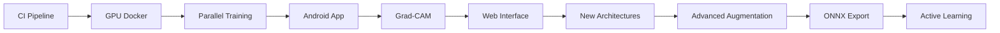

# Future Implementation Roadmap

> [!NOTE]
> This document outlines planned enhancements and research extensions. Items are grouped by priority and effort. Each entry includes a brief rationale and links to relevant code where applicable.

---

## 🔴 High Priority — Near-Term

### 1. GPU-Accelerated Docker Image
- **What:** Provide a dedicated `Dockerfile.gpu` or build-arg for `tensorflow/tensorflow:2.19.1-gpu` base image with CUDA support.
- **Why:** Full field experiments (36+ training jobs) take hours on CPU. GPU cuts this to minutes per fold.
- **Effort:** Low — swap base image, add NVIDIA runtime instructions.

### 2. Multi-Seed Parallel Training
- **What:** Extend `run_field_experiment.py` to run seeds in parallel across available GPUs/CPUs using `multiprocessing` or `subprocess` pools.
- **Why:** The current sequential loop is the main bottleneck (6 estates × 2 models × 3 seeds = 36 serial jobs).
- **Effort:** Medium — needs GPU memory management and proper logging.
- **Related:** [run_field_experiment.py](file:///e:/Tea-Disease-Deep-Learning/tea_leaf_reliability/scripts/run_field_experiment.py)

### 3. Android Deployment App
- **What:** Build a minimal Android app that loads the INT8 TFLite model, captures a photo, runs inference, and displays the prediction with confidence.
- **Why:** The research plan calls for Android benchmarking; a minimal app would also demonstrate real-world deployment.
- **Effort:** High — requires Android Studio, CameraX, and TFLite Android runtime integration.
- **Related:** [RESEARCH_PLAN.md § Android measurements](file:///e:/Tea-Disease-Deep-Learning/tea_leaf_reliability/RESEARCH_PLAN.md)

### 4. Automated CI/CD Pipeline
- **What:** Add GitHub Actions or similar CI that runs `make-demo` → `run` on every push to verify nothing is broken.
- **Why:** Protects against silent regressions in the training/export/calibrate/evaluate chain.
- **Effort:** Low — the demo pipeline is designed exactly for this.

---

## 🟡 Medium Priority — Mid-Term

### 5. Additional Architectures
- **What:** Add support for MobileNetV2, EfficientNet-Lite, and ConvNeXt-Tiny as architecture options.
- **Why:** Broader architecture comparison strengthens the generalisability claim.
- **Effort:** Medium — extend `ARCHITECTURES` in `learning.py`, validate export and quantization.
- **Related:** [learning.py](file:///e:/Tea-Disease-Deep-Learning/tea_leaf_reliability/tea_research/learning.py#L16)

### 6. Advanced Augmentation Strategies
- **What:** Implement CutMix, MixUp, and RandAugment as configurable augmentation policies.
- **Why:** Current augmentation is intentionally mild (flip, slight rotate/zoom/contrast). Stronger augmentation may improve generalisation across estates.
- **Effort:** Medium — integrate with the existing `dataset()` function's augmentation pipeline.
- **Related:** [learning.py](file:///e:/Tea-Disease-Deep-Learning/tea_leaf_reliability/tea_research/learning.py#L44-L64)

### 7. Grad-CAM / Explainability Visualisations
- **What:** Generate class activation heatmaps overlaid on input images to show which leaf regions drive the prediction.
- **Why:** Interpretability is critical for expert trust. Grad-CAM can reveal if models attend to disease symptoms vs. background artefacts.
- **Effort:** Medium — TensorFlow GradientTape on the Keras model, with Pillow overlay rendering.

### 8. ONNX Export Path
- **What:** Add an `--export-format onnx` option alongside TFLite.
- **Why:** Enables deployment on non-mobile edge devices (Raspberry Pi, Jetson) via ONNX Runtime.
- **Effort:** Medium — `tf2onnx` conversion + validation against TFLite outputs.

### 9. Web-Based Prediction Interface (✅ Completed)
- **Status:** Implemented in `web/` using **FastAPI** + **Vite React** with full INT8/FP32 condition switching, TRI Sri Lanka disease management guidelines, and selective referral alerts.
- **Related:** [web/](file:///e:/Tea-Disease-Deep-Learning/tea_leaf_reliability/web/README.md)

---

## 🟢 Lower Priority — Long-Term

### 10. Active Learning Pipeline
- **What:** After initial field deployment, rank images by model uncertainty and suggest them for expert review.
- **Why:** Reduces labelling cost by focusing expert effort on the most informative samples.
- **Effort:** High — needs an annotation UI, uncertainty ranking, and manifest re-generation.

### 11. Federated / On-Device Learning
- **What:** Explore on-device fine-tuning so models adapt to a specific estate's conditions without centralising images.
- **Why:** Privacy preservation for estate owners; adapts to local visual conditions (lighting, cultivar).
- **Effort:** Very High — requires TFLite transfer learning or federated framework.

### 12. Multi-Label and Severity Grading
- **What:** Extend from single-label classification to multi-label (co-occurring diseases) and severity grading (mild/moderate/severe).
- **Why:** Real-world leaves often show multiple symptoms; severity affects treatment decisions.
- **Effort:** High — annotation schema change, loss function modification, metric redesign.

### 13. Temporal / Longitudinal Tracking
- **What:** Track disease progression on the same bush/leaf across visits using `session_id` and `capture_date`.
- **Why:** Enables early-warning alerts and treatment efficacy monitoring.
- **Effort:** High — needs consistent leaf re-identification and time-series analysis.
- **Related:** [data.py](file:///e:/Tea-Disease-Deep-Learning/tea_leaf_reliability/tea_research/data.py#L22-L25)

### 14. UAV / Multispectral Integration
- **What:** Support multispectral (NIR, NDVI) image channels beyond RGB.
- **Why:** Some diseases are more visible in non-visible spectra; UAV surveys enable plantation-scale monitoring.
- **Effort:** Very High — different input preprocessing, sensor calibration, model architecture changes.

### 15. Model Compression Beyond INT8
- **What:** Explore pruning, knowledge distillation, and INT4/binary quantization.
- **Why:** Further reduces model size and latency for extremely constrained edge devices.
- **Effort:** High — TensorFlow Model Optimization Toolkit integration, accuracy validation.

---

## Implementation Order Suggestion

> [!TIP]
> Start with items 1 and 4 (CI + GPU Docker) as they have the lowest effort-to-impact ratio and unblock the more ambitious items downstream.
